  

  

  
  

---

## 🍥 About me

- 🛠️ Data Engineer focused on **Databricks, dbt and the medallion architecture**
- 🎓 Computer Science student at **Universidade de Brasília (UnB)**
- 🔍 Interested in data quality, pipeline reliability and applied AI (RAG, LLM apps)
- 🌐 Portuguese (native) · English (advanced) · Spanish (basic)

---

## 🧰 Tech stack

**Languages**

  

**Data engineering**

  
  
  
  
  
  
  
  

**Orchestration, governance & DevOps**

  
  
  
  
  
  

**BI & reporting**

  
  

---

## 📜 Featured projects

| Project | Description | Stack |
|---|---|---|
| [**LH Nautical**](https://github.com/leorb99/lh-nautical) | Data platform for a fictional e-commerce: SQL Server → Bronze ingestion via JDBC with automatic table discovery and parallel partitioned reads, Silver and Gold models in dbt with tests, docs and lineage, deployed with Databricks Asset Bundles and CI on Bitbucket Pipelines | Databricks · PySpark · Delta Lake · Unity Catalog · dbt |
| [**Brazilian Elections 2022**](https://github.com/leorb99/elections) | Exploratory analysis of TSE open data on 2022 federal deputy candidates: candidate profiles, declared assets and votes by municipality *(in progress)* | Python · pandas · Plotly · Jupyter |
| [**Course Review Platform**](https://github.com/leorb99/Projeto_BD) | Web app for students to review university classes, built on a relational model designed from scratch (ER diagram, DDL and migration scripts) | Python · Flask · MySQL · SQL |
| [**AI vs. Human Text Classifier**](https://github.com/leorb99/iia) | Comparison of supervised classifiers to detect AI-generated text, using TF-IDF features and ROC/AUC evaluation | Python · scikit-learn |
| [**GAN Plant Disease Detection**](https://github.com/leorb99/gan-pix2pix) | Unsupervised anomaly detection on leaf images with a Pix2Pix GAN, based on a published paper's color-reconstruction method | Python · PyTorch |

---

## 💼 Experience

- **Indicium AI** — Data Engineer Trainee (Lighthouse Program) and Sustainment team (Analytics/Data Engineer) · *2026*
- **Brazilian Chamber of Deputies** — Data Engineering Intern · *2024 – 2026*
  - Supported the corporate data warehouse and built ETL pipelines with Apache Hop and Talend (star schema)
  - Built a pipeline that delivers biweekly SAP BO reports to all 513 deputies via APIs
  - Cut the runtime of another team's legacy pipeline to less than half of the original

## 🏅 Certifications

- ✅ Databricks Certified Data Engineer Associate
- ✅ Databricks Fundamentals · Claude Code in Action (Anthropic)

---

## 📊 GitHub stats

 
     
     

  

<!-- Contribution snake (enable after setting up .github/workflows/snake.yml)

  <picture>
    <source media="(prefers-color-scheme: dark)" srcset="https://raw.githubusercontent.com/leorb99/leorb99/output/github-snake-dark.svg" />
    
  </picture>

-->

---

  🍜 If you liked a project, leave a ⭐. It's worth as much as a bowl of ramen after a long mission.

  

